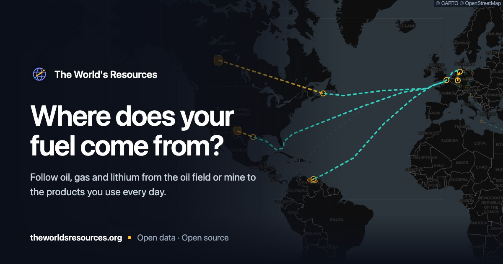

# The World's Resources

**Where does the fuel in your car, the gas in your heating or the lithium in your phone actually come from?**

The World's Resources is an open-source, interactive map of global resource flows: from the oil field or mine, through pipelines, ports and shipping lanes, to the refinery or plant – and finally to the products we use every day.

🌍 **Live:** [theworldsresources.org](https://www.theworldsresources.org)



## What you can do

- **Follow a supply chain.** Click a refinery, port, pipeline or oil field and the map highlights its whole chain – where the resource comes from and where it goes. The inspector lists every step; each one is clickable.
- **Find the "aha moment".** Every place explains why it matters in everyday life: the jet fuel for Frankfurt Airport, the lithium for EV batteries, the gas for your heating.
- **Focus on one resource or country.** Show only lithium, or everything that touches Chile, and see the country's supply corridors (e.g. Chile → Germany).
- **Share what you see.** Every node, route and view has its own link, e.g. [`#map/refinery-schwedt`](https://www.theworldsresources.org/#map/refinery-schwedt) or [`#map?view=good&good=lithium&country=CL`](https://www.theworldsresources.org/#map?view=good&good=lithium&country=CL).
- **Check the sources.** Every feature names its source and links to it.

### Current coverage

| Resource | Coverage |
|----------|----------|
| 🛢️ Crude oil | German import ports, pipelines (NWO, NDO, TAL, Rostock–Schwedt …) and refineries; tanker routes from the Gulf, Venezuela, the US and Canada; eight of the world's largest oil fields |
| 🔥 Natural gas & LNG | German LNG terminals, storage and the main transmission pipelines (NETRA, EUGAL, MEGAL) |
| 🔋 Lithium | Salar de Atacama (Chile) → Antofagasta → Panama Canal → Hamburg → BASF Schwarzheide |

The project started with Germany as a proof of concept. More resources (copper, electricity, hydrogen) and regions are welcome – see below.

## Contributing

Contributions of all sizes are welcome – no coding needed for most of them:

- **Data:** add a missing pipeline, port or refinery, connect a place to its supply chain, fix a coordinate or add a source.
- **Code:** fix a bug, improve accessibility or mobile layout, build new features.
- **Review:** check facts and sources, report anything that looks wrong.

👉 Start with **[CONTRIBUTING.md](CONTRIBUTING.md)**, and look for issues labelled [`good first issue`](https://github.com/LukasWitten/the-worlds-resources/labels/good%20first%20issue).

## Run it locally

Requires Node.js 20 or newer.

```bash
npm install
npm run dev
```

Then open the address shown in the terminal (usually `http://localhost:5173`).

| Command | What it does |
|---------|--------------|
| `npm run dev` | Development server with hot reload |
| `npm run validate:data` | Checks all GeoJSON data (schema, unique ids, route endpoints) |
| `npm run build` | Production build into `dist/` |
| `npm run preview` | Serves the build with the same security headers as the live site |

## How it works

- **Vanilla JavaScript** (ES modules), bundled with **Vite**. No framework.
- **Leaflet** for the map, **Tailwind CSS** for styling. Everything is bundled – no scripts or styles from third-party CDNs.
- **Data as GeoJSON** in `public/data/`, served as static files and validated against a JSON schema.
- **Routes reference their start and end node** (`from_node_id` / `to_node_id`), so all datasets together form a graph. The supply-chain view walks that graph.
- **Hosting** on Vercel; security headers (including a Content-Security-Policy) live in `vercel.json`.
- **CI** (GitHub Actions) validates the data and builds the site on every pull request.

### Project structure

```
├── public/
│   ├── data/                        # The only data source, served as-is under /data/
│   │   ├── reference/goods.json     # Goods catalogue: label, colour, icon, HS codes per resource
│   │   ├── geojson/
│   │   │   ├── germany/             # crude_oil, natural_gas
│   │   │   └── global/              # lithium, oil_fields, oil_export_corridors
│   │   ├── schemas/                 # JSON schema for every feature
│   │   ├── templates/               # Copy-paste examples for nodes and routes
│   │   └── LICENSE.md               # CC BY 4.0
│   └── favicon.svg, og-image.jpg …
├── src/
│   ├── app.js                       # Entry point, URL routing (#map/<id>)
│   ├── modules/
│   │   ├── dataService.js           # Loading and filtering the datasets
│   │   ├── mapState.js              # Central map state (view, resource, country, open feature) ↔ URL
│   │   ├── goods.js                 # Goods catalogue (labels, colours, icons)
│   │   ├── supplyChain.js           # Graph of nodes and routes, upstream/downstream chains, corridors
│   │   ├── map.js                   # Leaflet map, markers, routes, chain highlight
│   │   ├── inspector.js             # Detail drawer, aha moment, supply-chain timeline
│   │   ├── ui.js                    # Navigation, search, filters, dialogs
│   │   ├── colors.js                # Shared route colors
│   │   └── html.js                  # Escaping of data values (XSS protection)
│   └── styles/main.css
├── scripts/validate-data.js         # Data validator used locally and in CI
├── docs/
│   ├── CONTRIBUTING_DATA.md         # Full guide to the data format
│   ├── PROJECT_SPECIFICATIONS.md    # Vision and concept
│   └── MINI_EDITOR_PLAN.md          # Plan for an in-browser route editor
├── index.html
└── vercel.json                      # Build settings and security headers
```

## License

- **Code:** [MIT](LICENSE)
- **Data** (`public/data/geojson/`): [CC BY 4.0](public/data/LICENSE.md)

Suggested attribution when you reuse the data:
"Data: © The World's Resources contributors (theworldsresources.org), CC BY 4.0"

Basemap © [OpenStreetMap](https://www.openstreetmap.org/copyright) contributors, © [CARTO](https://carto.com/).
